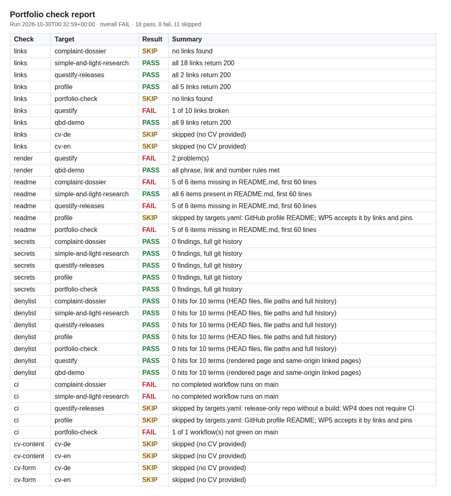

# portfolio-check

Checks every public link, demo page and README in my portfolio the way a logged-out visitor in a fresh browser sees them. The same tool checks my CV files, but only on my machine: CI skips the CV checks, and I run them locally before sending a CV.



## Try it

```bash
git clone https://github.com/vassiljevnikita-sudo/portfolio-check && cd portfolio-check
pip install -e . && python -m playwright install chromium
python -m portfolio_check --check readme --check links --target simple-and-light-research
```

The run prints one line per check, writes `report.md` and `report.json`, and exits with 1 if any check failed. The daily run's report is attached to the latest [portfolio workflow run](https://github.com/vassiljevnikita-sudo/portfolio-check/actions/workflows/portfolio.yml).

## What it checks

| Check | Passes when |
| --- | --- |
| `links` | every URL in a README, site or CV answers 200 within 10 s and does not redirect to a login page |
| `render` | the site, opened in headless Chromium, shows the required phrases and links, none of the forbidden ones, and enough numbers |
| `readme` | the first 60 lines of a README hold a problem statement, a screenshot, a "Try it" command, "My role", the tech stack and the limitations |
| `secrets` | gitleaks finds nothing in the full git history |
| `denylist` | none of the private terms appears in a repo (files and history) or on a site |
| `ci` | the latest completed GitHub Actions run on the default branch succeeded |
| `cv-content` | the CV `.docx` has the required sections, keywords and claims and none of the forbidden phrases |
| `cv-form` | the CV is at most 2 pages as PDF, has no nested tables and LanguageTool finds no error outside `allowlist.txt` |

Targets live in [`targets.yaml`](targets.yaml), CV rules in [`cv_rules.yaml`](cv_rules.yaml).

The repo checks cover every public repository of mine that is not a fork: complaint-dossier, simple-and-light-research, questify-releases, portfolio-check, my profile README and the side project safeincloud-linux. Forks are left out, because they hold other people's code and history.

## My role

I defined the eight checks and their pass rules for my job applications. Most of the code and the tests were written by an AI coding agent from that specification.

## Tech stack

Python 3.10+, requests, Playwright with Chromium, gitleaks, python-docx, LibreOffice headless, pypdf, the LanguageTool HTTP API, pytest and GitHub Actions.

## Limitations

- The README check looks for headings and labels. It cannot tell whether the text under them is any good.
- CV text goes to the public LanguageTool API unless `LANGUAGETOOL_URL` points to a self-hosted server. The public API also has a rate limit.
- CV files hold personal data and are not stored here. CI therefore skips the CV checks (`skipped: no CV path given`), and the report says that a skip is not a pass. I check the CVs locally before sending them, with the CV command under Usage.
- Any status other than 200 counts as broken, including sites that block automated requests. One exception, listed under `link_exceptions` in `targets.yaml`: Google Scholar answers 403 to GitHub's runners, so CI reports that link as "not verified from CI" instead of failing. A local run still needs 200.
- Denylist matching is a plain substring search, so short terms also hit inside longer words. The report marks those hits.
- GitHub cron runs in UTC, so the daily run starts at 06:00 Berlin time in winter and 07:00 in summer.

## Usage

```text
python -m portfolio_check --all                       # everything, the default
python -m portfolio_check --check NAME --target NAME  # one check, one target; both flags repeat
python -m portfolio_check --list                      # checks and targets
python -m portfolio_check --check cv-content --check cv-form --check links \
    --target cv-de --target cv-en --cv-de PATH.docx --cv-en PATH.docx   # the CV checks
```

Other options:

- `--local NAME=PATH` checks a local checkout or file instead of the public source, for example `--local complaint-dossier=../complaint-dossier` before opening a pull request. Relative README links then have to exist in that folder.
- `--cv-de PATH` and `--cv-en PATH` (or `PORTFOLIO_CV_DE` and `PORTFOLIO_CV_EN`) name the CV files. Without them the CV checks are skipped; `--require-cv` makes them fail instead.
- `--allowlist-file PATH` (or `PORTFOLIO_ALLOWLIST`) adds LanguageTool exceptions that should not be public, such as employer names and my address. It uses the same format as `allowlist.txt`: one term per line, or `span: TEXT` to exempt an exact passage like a citation in another language.
- `--denylist-file PATH` reads the private terms from a file. Otherwise they come from the `DENYLIST` environment variable, one term per line. Reports name a hit as "term #3", never the term itself.
- `--out DIR` sets where reports, screenshots and the repo clone cache go.

Environment variables: `GITHUB_TOKEN` (API rate limit; falls back to `gh auth token`), `LANGUAGETOOL_URL`, `GITLEAKS_BIN`, `SOFFICE_BIN`.

Repos are cloned anonymously with credential helpers switched off, so a private repo fails the same way it fails for a visitor.

## CI

- [`test.yml`](.github/workflows/test.yml) runs the unit tests and checks this README on every push and pull request. It is this repo's CI status.
- [`portfolio.yml`](.github/workflows/portfolio.yml) runs `--all` on push to `main`, on demand and daily at 05:00 UTC. It has no CV files, so the CV checks are skipped there. It fails when any check fails and uploads `report.md`, `report.json` and the screenshots as the `portfolio-report` artifact.
- GitHub switches off scheduled workflows in a public repo after 60 days without repository activity. The `keepalive` job in `portfolio.yml` therefore calls the API endpoint that enables the workflow on every run. If the daily runs ever stop anyway, re-enable the workflow on the Actions tab.

## Development

```bash
pip install -e ".[dev]"
pytest
```

The tests mock the network, gitleaks, LibreOffice and LanguageTool, so they run offline in about a second. Test data is synthetic.
